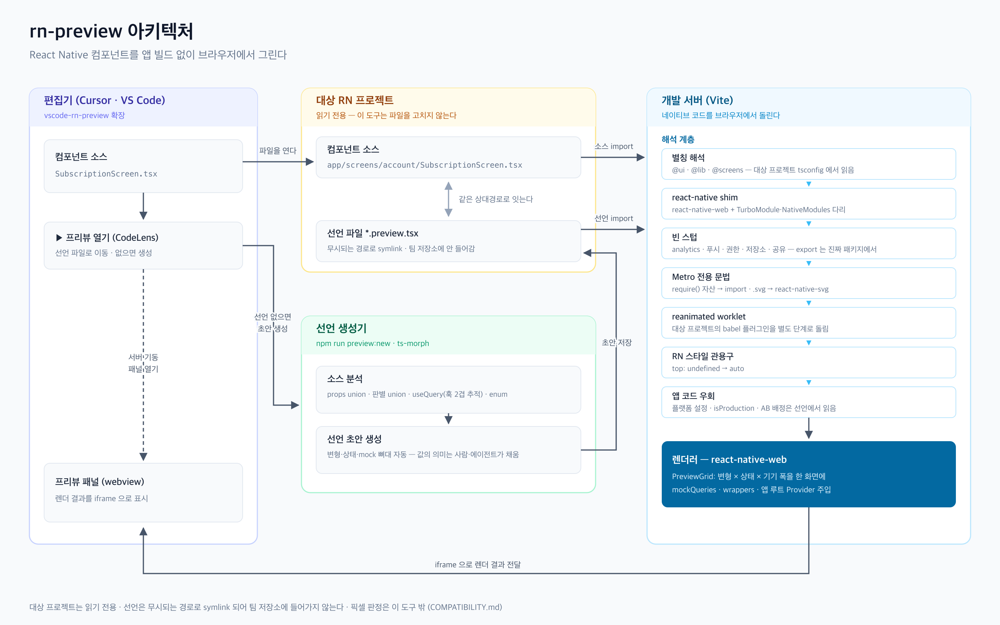

# rn-preview

React Native 컴포넌트를 앱을 빌드하지 않고 브라우저에서 봅니다.
`react-native-web` 으로 그리므로 근사이고, 픽셀 판정은 이 도구 밖에 남습니다.

_English: [README.md](README.md)_

에이전트에게 설치를 맡기려면 [docs/AGENT-SETUP.ko.md](docs/AGENT-SETUP.ko.md) 를 그대로 넘깁니다.

한 화면에서 변형과 기기 폭을 나란히 비교하는 것이 목적입니다. 실기로는 한 번에 하나씩만 봅니다.

## 아키텍처



편집기 확장이 열려 있는 파일 경로만으로 선언을 찾고(없으면 초안을 만들고), Vite 해석 계층이
대상 프로젝트 소스를 웹에서 돌게 바꾼 뒤 react-native-web 으로 그립니다. 각 계층이 왜 필요한지는
[docs/HOW-IT-WORKS.ko.md](docs/HOW-IT-WORKS.ko.md) 에, 청사진 원본은
[docs/architecture.ko.svg](docs/architecture.ko.svg) 에 있습니다.

## 준비물

- Node.js 22 이상.
- `package.json` 이 `react-native` 를 의존하는 RN 프로젝트. 그 프로젝트 `tsconfig.json` 의 별칭(`paths`·`baseUrl`·
  `extends`)은 그대로 읽습니다.
- React Query·React Navigation·`react-native-safe-area-context` 는 없어도 됩니다. 앱이 설치했으면 앱의 것을 함께
  쓰고, 없으면 작은 대역이 그 자리를 채웁니다.
- `node_modules` 를 앱 위로 끌어올리는 모노레포는 검증하지 않았습니다.

## 쓰기

```bash
npm install
npm run dev
```

대상 RN 프로젝트와 선언 디렉토리는 이 순서로 정합니다.

| 순위 | 출처                                       | 쓰는 곳                  |
| ---- | ------------------------------------------ | ------------------------ |
| 1    | `RN_PREVIEW_CONFIG` 가 가리키는 JSON       | 이것만 씁니다(아래 주의) |
| 2    | `MOBILE_APP_PATH` · `PREVIEW_DIR` 환경변수 | 편집기 확장과 자동화     |
| 3    | `rn-preview.local.json` (형상관리 제외)    | 이 클론의 평소 대상      |
| 4    | 형제 디렉토리 탐색 · `previews`            | 아무것도 안 줬을 때      |

**환경변수가 `rn-preview.local.json` 보다 셉니다.** 그 파일은 평소 대상을 적어둔 것이고 환경변수는
그 실행에서 볼 대상을 집어 주는 것이라, 워크트리를 지정하면 그쪽이 이겨야 합니다.

형제 탐색은 `react-native` 를 의존하는 폴더가 하나일 때만 씁니다. 워크트리를 옆에 두면 후보가
여럿이 되어 목록을 보여주고 멈춥니다. 그때는 2·3번으로 지정합니다.

`RN_PREVIEW_CONFIG` 를 주면 선언 디렉토리 옆의 `rn-preview.config.json` 을 **병합하지 않습니다.**
대체 모듈과 루트 Provider 까지 그 파일에 담아야 하고, 안 담으면 화면이 통째로 안 뜹니다.

대상 프로젝트의 **소스는 읽기 전용**입니다. 이 도구는 그쪽 컴포넌트를 하나도 고치지 않습니다.

예외는 선언 디렉토리 하나뿐입니다. 그 안에 편집기용 `tsconfig.json` 을 만들어 둡니다(아래 "선언
파일"). 선언 디렉토리가 대상 저장소 안이면 그 경로를 `.gitignore` 에 넣으세요. 넣지 않으면 생성물이
커밋 후보로 올라옵니다.

## 선언 파일

대상 프로젝트의 `previews/` 아래에 `*.preview.tsx` 를 둡니다. `PREVIEW_DIR` 이나
`rn-preview.local.json` 의 `previewRoot` 로 다른 곳을 가리킬 수 있습니다.

선언을 팀 저장소에 넣고 싶지 않으면 무시되는 디렉토리로 빼고 그 경로를 지정합니다. 개인 저장소로
나가는 symlink 를 두고 앱은 그 디렉토리를 통째로 무시하게 하는 배치가 하나의 방법입니다.
컴포넌트를 고치는 창에서 선언이 함께 보이면서도 팀 저장소에는 안 들어갑니다.

선언 디렉토리에는 `tsconfig.json` 이 함께 생성됩니다. 대상 프로젝트의 tsconfig 는 그 디렉토리를
대상에 넣지 않아서, 그것 없이는 그 창에서 `@preview` 나 프로젝트 별칭이 하나도 안 잡힙니다.
**디렉토리가 이미 있을 때만 만듭니다** — 선언이 하나도 없는 자리에 편집기용 파일만 남기지
않습니다. 생성물이므로 대상 저장소 안에 두면 그 경로를 `.gitignore` 에 넣으세요.

**선언 위치는 소스 경로에서 나옵니다.** `sourceRoot` 아래 상대경로를 그대로 씁니다. 기본값은 프로젝트
루트입니다. 코드가 `src/` 처럼 한 디렉토리 아래에 모여 있으면 아래 "프로젝트별 설정" 의 `sourceRoot` 로 그
디렉토리를 지정해 선언 경로를 짧게 둘 수 있습니다.

```
src/screens/account/SubscriptionScreen.tsx
  -> src/screens/account/SubscriptionScreen.preview.tsx   (기본값)
  -> screens/account/SubscriptionScreen.preview.tsx       ("sourceRoot": "src")
```

손으로 안 써도 됩니다. 초안을 만들어 줍니다.

```bash
npm run preview:new -- ../my-rn-app/src/ui/components/badge/Badge.tsx
```

props 타입에서 변형을, `useQuery` 에서 쿼리 키와 mock 뼈대를, enum 필드에서 상태를 뽑습니다.
값의 의미(플랜 이름, 금액)는 사람이나 에이전트가 채웁니다. 이미 있으면 건드리지 않고, `--force` 로
다시 만듭니다.

기기 크기 기본값은 375 × 795 입니다. `widths` 와 `height` 로 바꿉니다.

## 프로젝트별 설정

프로젝트마다 다른 것은 **선언 디렉토리 옆의 `rn-preview.config.json`** 이 갖습니다. 대체 모듈처럼 그
프로젝트 사정을 아는 코드를 가리키기 때문에 도구에 둘 수 없습니다. 그대로 쓸 수 있는 예시가
[docs/rn-preview.config.example.json](docs/rn-preview.config.example.json) 에 있습니다.

| 필드                   | 타입                            | 경로 기준                     | 뜻                                                                                    |
| ---------------------- | ------------------------------- | ----------------------------- | ------------------------------------------------------------------------------------- |
| `sourceRoot`           | `string`                        | 프로젝트                      | 미리 볼 소스가 있는 디렉토리. 선언 경로가 이 아래 구조를 따름. 기본값은 프로젝트 루트 |
| `nonRenderingPackages` | `string[]`                      | —                             | 화면을 그리지 않아 통째로 비울 패키지. `*` 를 쓸 수 있음. 기본값 없음                 |
| `sharedPackages`       | `string[]`                      | —                             | 앱과 같은 인스턴스를 써야 하는 패키지. 기본 목록에 더해짐                             |
| `fontDirs`             | `string[]`                      | 프로젝트                      | 앱이 링크한 폰트 디렉토리. 기본값 `ios/fonts` 에 더해짐                               |
| `moduleOverrides`      | `Record<string, string>`        | 키=프로젝트, 값=선언 디렉토리 | 프리뷰에서만 다른 구현을 쓸 프로젝트 파일                                             |
| `rootProviders`        | `string[]`                      | 선언 디렉토리                 | 모든 칸에 씌울 Provider. children 을 받는 컴포넌트를 default export                   |
| `importRedirects`      | `{ importerUnder, from, to }[]` | 프로젝트                      | 배럴 순환처럼 특정 디렉토리 안에서만 돌려야 하는 해석                                 |

**`sourceRoot` 는 디렉토리 구성으로 추측하지 않습니다.** 잘못 고르면 선언 경로가 한꺼번에 옮겨져 기존 선언이
오류 없이 소스와 끊깁니다. 선언을 쌓기 전에 한 번 정해 둡니다.

**`nonRenderingPackages` 는 기본값이 없습니다.** 무엇을 쓰는지는 프로젝트마다 다르고, 목록 자체가 그 앱이
어느 analytics·attribution·crash 벤더를 쓰는지 드러내서 도구에 박아 두지 않았습니다. 안 적으면 그 패키지를
스치는 화면이 통째로 안 뜨고, 어느 모듈이 막혔는지는 `node scripts/whyNotBundled.mjs <모듈>` 로 봅니다.

**주석을 쓸 수 없습니다.** 이 파일은 `JSON.parse` 로 읽으므로 `//` 가 있으면 "프리뷰 설정을 읽지
못했습니다" 로 멈춥니다. 순수 JSON 으로 씁니다.

**대상 프로젝트와 선언 디렉토리는 이 파일로 정하지 못합니다.** 그 둘이 정해진 뒤에 이 파일을 찾기
때문입니다. 위 "쓰기" 의 경로 우선순위를 씁니다. `RN_PREVIEW_CONFIG` 를 주면 이 파일은 **병합되지
않습니다.**

기계를 옮겨도 같은 설정을 쓰려면 선언 디렉토리를 개인 저장소로 symlink 하고 이 파일을 그 저장소에
두면 됩니다. 선언과 대체 구현과 설정이 한 벌로 따라옵니다.

## 기기 조건 축

실기기에서만 볼 수 있다고 여기던 것들을 선언으로 세웁니다.

| 필드             | 하는 일                                                                                                                |
| ---------------- | ---------------------------------------------------------------------------------------------------------------------- |
| `fontScales`     | OS 글자 배율. `[1, 1.3]` 이면 배율 칸이 옆에 붙습니다. 폰트 크기와 행간을 함께 키워 카드 안쪽 요소까지 배율을 받습니다 |
| `insets`         | safe area 인셋. 기본은 노치 기기(top 44 · bottom 34)이고, 홈버튼 기기는 `{ top: 20, bottom: 0 }` 입니다                |
| `platformChrome` | 상태바·홈 인디케이터 자리를 겹쳐 그립니다. `*Screen` 선언과 시트는 기본으로 켜집니다                                   |
| `lottieFrame`    | Lottie 가 멈출 프레임. 기본은 마지막 프레임이고 `'first'`·`'middle'`·번호·`'play'` 를 고릅니다                         |

```tsx
export default definePreview({
    component: SubscriptionScreen,
    variants: { 기본: {} },
    fontScales: [1, 1.3],
    insets: { top: 20, bottom: 0 },
    states: { … },
});
```

기기 크롬은 실기가 그리는 것이라 `--geometry` 산출에서 빠집니다. 사람 눈에는 보이되 시안 대조
술어에는 안 잡힙니다.

칸은 `overflow: hidden` 이라 기기 높이를 넘은 것은 캡처에 안 보입니다. 배율에서 하단 버튼이
밀려나는 것이 대표적입니다. 그래서 `--geometry` 산출에 칸마다 `clipped`(넘은 px)와
`clippedTexts`(밖으로 나간 문구)를 함께 적습니다. 배율 칸의 `clippedTexts` 가 기본 칸보다 늘었으면
그 문구가 큰글씨에서 사라집니다.

실기기 확인을 대체하지는 않습니다. 자간과 rn-web 폰트 메트릭이 실기와 달라서, 줄바꿈과 넘침을
헤드리스에서 미리 보는 용도입니다.

```tsx
import { definePreview } from '@preview';
import { Badge } from '@ui/components/badge/Badge';

export default definePreview({
    component: Badge,
    variants: {
        기본: { label: '배지' },
        강조: { label: '배지', type: 'strong', variant: 'brand' },
        긴라벨: { label: '아주 긴 배지 라벨이 들어간 경우' },
    },
    widths: [360, 390],
});
```

`definePreview` 는 데이터만 받고 데이터만 돌려줍니다. JSX 를 넘기면 그 자리에서 렌더러가 정해져서,
나중에 네이티브 렌더러를 붙일 때 선언을 다시 써야 합니다.

**배럴(`@ui`)이 아니라 직접 경로로 가져옵니다.** 배럴은 컴포넌트 전체를 함께 내보내서 하나만 쓰려 해도
analytics·deeplink 같은 네이티브 패키지가 딸려옵니다.

### 글자 배율 곡선

숫자 배율은 선형입니다. iOS 와 Android 13 이하가 이렇게 키웁니다. iOS 단계는 1.118·1.235·1.353 이고
1.3 단계는 없습니다. Android 14 이상은 큰 글자를 덜 키우는 곡선을 씁니다(1.3 에서 20sp → 23.6dp,
선형이면 26). 선형 1.3 칸이 접는 줄을 Android 14 기기는 한 줄로 그릴 수 있습니다. 그 기기를 보려면
`{ scale: 1.3, curve: 'android14' }` 를 적습니다. 표는 Android SDK 의 `FontScaleConverterFactory` 값을
그대로 씁니다(1.05·1.1·1.15·1.2·1.3·1.5·1.8·2).

`allowFontScaling={false}` 인 텍스트는 키우지 않고 `maxFontSizeMultiplier` 는 상한으로 씁니다. 중첩
텍스트는 부모 값을 물려받습니다. Android 곡선 칸은 행간에 상한을 걸지 않고(RN Android 와 같음) 선형
칸은 iOS 처럼 글자와 행간에 같은 상한을 겁니다.

### 시간축

타이머로 바뀌는 화면(스스로 사라지는 인트로, 토스트, 늦게 뜨는 툴팁)은 캡처가 그 타이머와 경주합니다.
페이지가 몇 초 만에 떴는지에 따라 타이머 앞이 찍히기도 하고 뒤가 찍히기도 합니다. 아래 필드를 주면
캡처가 시계를 멈춘 채 페이지를 열고 시점마다 시계만 앞당겨 찍습니다. 브라우저·편집기에서 볼 때는
영향이 없습니다.

| 필드        | 하는 일                                                                                                    |
| ----------- | ---------------------------------------------------------------------------------------------------------- |
| `timeline`  | 로드가 끝난 뒤 몇 ms 시점을 찍을지. `[0, 2400]` 이면 `{이름}@0ms.png`·`{이름}@2400ms.png` 두 장이 나옵니다 |
| `filmstrip` | 전환을 프레임으로 보기. `{ durationMs: 600, stepMs: 100 }` 이면 100ms 간격 7장. `timeline` 과 합쳐집니다   |
| `now`       | 캡처 중 시계가 시작하는 날짜. 오늘 날짜를 읽는 화면(달력, 남은 일수)이 날마다 다르게 찍히지 않게 합니다    |

### 조작 뒤 상태

탭·펼침·선택처럼 컴포넌트 안 `useState` 로 갈리는 분기는 props 나 응답으로 닿을 수 없어 초기값 쪽만
찍힙니다. `interactions` 로 캡처 직전에 칸 안의 요소를 누릅니다.

```tsx
export default definePreview({
    component: Sheet,
    variants: { default: { ... } },
    states: { before: [], after: [] },
    interactions: { after: [{ press: '바로 시작하기' }] },
});
```

- 키는 `states` 의 열 이름입니다. 없는 이름이면 선언을 읽는 단계에서 오류입니다. 조작 전 모습도 필요하면 위처럼
  같은 `mockQueries` 로 열을 하나 더 둡니다.
- `press` 는 칸 안에 그려진 문구와 정확히 같아야 합니다. 단어가 끊기지 않게 앱이 넣는 U+2060 은 무시하므로
  화면에 보이는 대로 적습니다. 칸 범위 밖은 찾지 않습니다. 칸 안에 0개거나 2개 이상이면 **캡처가 실패**합니다.
  메시지에 어느 열·칸·문구인지 나옵니다.
- 해당 열의 모든 칸에서 차례로 playwright 실제 클릭(포인터 이벤트)을 합니다. 클릭마다 애니메이션이 끝나기를
  기다린 뒤 다음으로 갑니다. `--geometry` 는 조작이 끝난 화면을 기준으로 냅니다.
- `timeline`·`filmstrip` 과는 함께 쓸 수 없습니다(시계 전진과 순서가 얽힙니다). 오류로 막습니다.
- 브라우저·편집기 화면에서도 같은 문구를 누릅니다. 시트가 열린 뒤(0.8초)부터 0.3초 간격으로 포인터 이벤트를 보냅니다.
  누르지 못하면 그 칸 위에 빨간 띠로 사유가 뜹니다. 캡처할 때는 캡처가 직접 클릭하므로 화면 쪽은 누르지 않습니다.

## 편집기에서 보기

RN Preview 확장([소스](https://github.com/sean5940/vscode-rn-preview))을 설치하면 Cursor·VS Code 패널에서 봅니다.
VS Code 는 [Marketplace](https://marketplace.visualstudio.com/items?itemName=sean5940.vscode-rn-preview), Cursor 는
[Open VSX](https://open-vsx.org/extension/sean5940/vscode-rn-preview) 에서 받습니다. 확장에 이 도구가 실려 있어 따로
설치할 것이 없습니다. 컴포넌트 위의 `▶ Open preview` 를 누르면 개발 서버가 뜨고 그 선언이 선택된 채로 열립니다.


## 구성

```text
src/         렌더러와 해석 계층 (별칭·스텁·변환·프리뷰 그리드)
src/stubs/   react-native shim 과 빈 스텁
scripts/     선언 초안 생성기와 진단 도구
docs/        동작 방식 문서와 아키텍처 청사진
test/        vitest 테스트
```

도구 자체의 테스트는 `npm test` 로 돕니다.

## 안 뜰 때

브라우저 콘솔은 첫 오류만 보여줍니다. 어떤 모듈이 왜 막혔는지는 아래로 봅니다.

```bash
node scripts/whyNotBundled.mjs '@ui/components/badge/Badge'
```

`X is not exported` 가 나오면 그 이름을 `src/stubs/nativeStub.ts` 에 더합니다.

토큰 이름을 잘못 적은 선언은 화면에서 티가 안 납니다. 지정한 색이 안 먹은 채 기본값으로 그려집니다.
선언 전체를 한 번에 검사합니다.

```bash
npm run typecheck:previews
```

동작 여부와 한계는 `COMPATIBILITY.ko.md` 에 있습니다.
