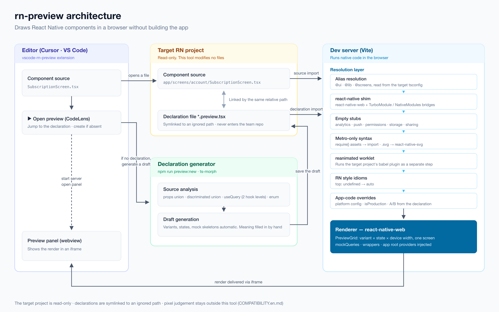

# rn-preview

Render React Native components in a browser without building the app.
Rendering goes through `react-native-web`, so it is an approximation — pixel-level judgement stays outside this tool.

_Korean: [README.ko.md](README.ko.md)_

To hand installation to a coding agent, pass [docs/AGENT-SETUP.md](docs/AGENT-SETUP.md) as-is.

The point is to compare variants and device widths side by side on one screen. On a real device you only ever see one at a time.

## Architecture



The editor extension locates a declaration from nothing but the path of the open file (generating a draft if there is none),
the Vite resolution layer rewrites the target project's sources so they run on the web, and `react-native-web` draws them.
Why each layer is needed is in [docs/HOW-IT-WORKS.md](docs/HOW-IT-WORKS.md); the blueprint source is
[docs/architecture.svg](docs/architecture.svg).

## Requirements

- Node.js 22 or later.
- A React Native project whose `package.json` depends on `react-native`. Aliases from its `tsconfig.json` (`paths`,
  `baseUrl`, `extends`) are picked up as they are.
- React Query, React Navigation and `react-native-safe-area-context` are optional. When the app installs them the
  preview shares the app's copy; when it does not, small stand-ins take their place.
- Monorepos that hoist `node_modules` above the app have not been tested.

## Usage

```bash
npm install
npm run dev
```

The target RN project and the declaration directory are resolved in this order.

| Rank | Source                                              | Used by                          |
| ---- | --------------------------------------------------- | -------------------------------- |
| 1    | the JSON that `RN_PREVIEW_CONFIG` points at         | this file only (see the caution) |
| 2    | `MOBILE_APP_PATH` · `PREVIEW_DIR` env vars          | editor extension and automation  |
| 3    | `rn-preview.local.json` (not under version control) | this clone's usual target        |
| 4    | sibling-directory lookup · `previews`               | when you passed nothing          |

**Environment variables beat `rn-preview.local.json`.** That file records the usual target; an environment variable
picks the target for one run, so when you name a worktree it has to win.

Sibling lookup applies only when exactly one folder depends on `react-native`. Put a worktree next to it and there are
several candidates, so the tool prints the list and stops. Name the target with 2 or 3 in that case.

If you pass `RN_PREVIEW_CONFIG`, the `rn-preview.config.json` next to the declaration directory is **not merged in.**
Module overrides and root providers have to live in that one file too — leave them out and nothing renders at all.

The target project's **sources are read-only.** This tool does not modify a single component over there.

The one exception is the declaration directory. A `tsconfig.json` for the editor is generated inside it (see
"Declaration files" below). If the declaration directory sits inside the target repository, add its path to that repo's
`.gitignore` — otherwise the generated file shows up as a commit candidate.

## Declaration files

Put `*.preview.tsx` files under the target project's `previews/`. `PREVIEW_DIR` or `previewRoot` in
`rn-preview.local.json` can point somewhere else.

If you would rather keep declarations out of the team repository, move them to an ignored directory and point at it.
One workable arrangement is a symlink out to a personal repository plus a blanket ignore on that directory in the app:
declarations stay visible in the same window where you edit the component, without entering the team repository.

A `tsconfig.json` is generated alongside the declarations. The target project's tsconfig does not include that
directory, so without it neither `@preview` nor any project alias resolves in that window.
**It is only created when the directory already exists** — no editor-only files are left behind in a spot that holds no
declarations. Since it is generated, add its path to the target repository's `.gitignore` if it lives inside that repo.

**Declaration location follows the source path.** The relative path under `sourceRoot` is reused verbatim. It
defaults to the project root. If your code lives under one directory such as `src/`, point `sourceRoot` at it (see
"Per-project settings" below) to keep declaration paths short.

```
src/screens/account/SubscriptionScreen.tsx
  -> src/screens/account/SubscriptionScreen.preview.tsx   (default)
  -> screens/account/SubscriptionScreen.preview.tsx       ("sourceRoot": "src")
```

You do not have to write it by hand. A draft is generated for you.

```bash
npm run preview:new -- ../my-rn-app/src/ui/components/badge/Badge.tsx
```

Variants come from the props type, query keys and mock skeletons from `useQuery`, and states from enum fields.
What the values mean (plan names, amounts) is filled in by a person or an agent. An existing declaration is left
untouched; `--force` regenerates it.

The device size defaults to 375 × 795. Change it with `widths` and `height`.

## Per-project settings

What differs from project to project lives in **`rn-preview.config.json` next to the declaration directory.** Some of
it points at code that knows that project's circumstances, such as replacement modules, so it cannot live in the tool.
A ready-to-adapt example is in [docs/rn-preview.config.example.json](docs/rn-preview.config.example.json).

| Field                  | Type                            | Relative to                       | Meaning                                                                                             |
| ---------------------- | ------------------------------- | --------------------------------- | --------------------------------------------------------------------------------------------------- |
| `sourceRoot`           | `string`                        | project                           | Directory holding the sources to preview. Declaration paths mirror it. Defaults to the project root |
| `nonRenderingPackages` | `string[]`                      | —                                 | Packages that draw nothing, emptied wholesale. `*` is allowed. No default                           |
| `sharedPackages`       | `string[]`                      | —                                 | Packages that must share one instance with the app. Added to the defaults                           |
| `fontDirs`             | `string[]`                      | project                           | Font directories the app links. Added to the default `ios/fonts`                                    |
| `moduleOverrides`      | `Record<string, string>`        | key: project, value: declarations | Project files to swap for a preview-only implementation                                             |
| `rootProviders`        | `string[]`                      | declarations                      | Providers wrapped around every cell. Each default-exports a component that takes children           |
| `importRedirects`      | `{ importerUnder, from, to }[]` | project                           | Resolution detours confined to one directory, such as cutting a barrel cycle                        |

**`sourceRoot` is not guessed from your folders.** Guessing wrong would move every declaration path at once, and the
existing declarations would stop matching their sources without any error. Decide it once before declarations pile up.

**`nonRenderingPackages` has no default.** Which ones a project uses differs per project, and the list itself reveals
which analytics, attribution, and crash vendors the app runs on, so none are baked into the tool. Leave one out and any
screen that touches it fails to mount; find the blocked module with `node scripts/whyNotBundled.mjs <module>`.

**Comments are not allowed.** The file is read with `JSON.parse`, so a `//` stops the tool with "Could not read the
preview config". Write plain JSON.

**This file cannot pick the target project or the declaration directory.** It is looked up after those two are
decided, so use the order under "Usage" above. With `RN_PREVIEW_CONFIG` set, this file is **not merged in.**

To keep the same settings across machines, symlink the declaration directory to a personal repository and keep this
file there. Declarations, replacement implementations and settings then travel together.

## Device-condition axes

Things you used to need a real device for are set up declaratively.

| Field            | What it does                                                                                                                               |
| ---------------- | ------------------------------------------------------------------------------------------------------------------------------------------ |
| `fontScales`     | OS text scale. `[1, 1.3]` puts a scaled cell alongside. Font size and line height grow together, so elements nested inside cards scale too |
| `insets`         | Safe-area insets. The default is a notched device (top 44 · bottom 34); a home-button device is `{ top: 20, bottom: 0 }`                   |
| `platformChrome` | Overlays the status bar and home indicator. On by default for `*Screen` declarations and sheets                                            |
| `lottieFrame`    | The frame Lottie stops on. The last frame by default; `'first'`, `'middle'`, a number, or `'play'`                                         |

```tsx
export default definePreview({
    component: SubscriptionScreen,
    variants: { default: {} },
    fontScales: [1, 1.3],
    insets: { top: 20, bottom: 0 },
    states: { … },
});
```

Device chrome is drawn by the real device, so it is excluded from `--geometry` output. A human sees it; the
design-comparison predicates do not.

Cells are `overflow: hidden`, so anything past the device height is invisible in a capture. A bottom button pushed off
by text scaling is the common case, so `--geometry` output records `clipped` (overflow in px) and `clippedTexts`
(strings that went outside) per cell. If a scaled cell's `clippedTexts` grew relative to the base cell, that string
disappears at large text sizes.

This does not replace checking on a real device. Letter spacing and rn-web font metrics differ from native — the point
is to see line breaks and overflow ahead of time, headlessly.

```tsx
import { definePreview } from '@preview';
import { Badge } from '@ui/components/badge/Badge';

export default definePreview({
    component: Badge,
    variants: {
        default: { label: 'Badge' },
        strong: { label: 'Badge', type: 'strong', variant: 'brand' },
        longLabel: { label: 'A badge label that runs quite long' },
    },
    widths: [360, 390],
});
```

`definePreview` takes data and returns data. Pass JSX and the renderer is decided right there, which means rewriting
every declaration when a native renderer is added later.

**Import through a direct path, not a barrel.** A barrel re-exports every component together, so pulling in one of them
drags along native packages for analytics, deep links, and the rest.

### Text-scale curves

A number scales linearly, which is how iOS and Android 13 and below grow text. iOS steps are 1.118, 1.235 and 1.353;
there is no 1.3 step. Android 14 and later use a curve that grows large text less (at 1.3, 20sp becomes 23.6dp
rather than 26), so a line a linear 1.3 cell wraps can stay on one line on an Android 14 device. Write
`{ scale: 1.3, curve: 'android14' }` to see that device. The tables are the Android SDK's `FontScaleConverterFactory`
values (1.05, 1.1, 1.15, 1.2, 1.3, 1.5, 1.8, 2).

Text with `allowFontScaling={false}` is not scaled and `maxFontSizeMultiplier` caps it. Nested text inherits both from
its parent. An Android-curve cell leaves line height uncapped (as RN does on Android); a linear cell caps font size and
line height alike, as iOS does.

### Time axis

A screen that changes on a timer (an intro that hides itself, a toast, a delayed tooltip) races the capture: whether
the shot lands before or after the timer depends on how long the page took to load. With the fields below the capture
opens the page on a stopped clock and only advances it to each moment. Viewing in a browser or editor is unaffected.

| Field       | What it does                                                                                                     |
| ----------- | ---------------------------------------------------------------------------------------------------------------- |
| `timeline`  | Moments to shoot, in ms after loading finished. `[0, 2400]` yields `{name}@0ms.png` and `{name}@2400ms.png`      |
| `filmstrip` | Watching a transition frame by frame. `{ durationMs: 600, stepMs: 100 }` yields 7 shots. Merged with `timeline`  |
| `now`       | The date the clock starts from during a capture, so screens that read today's date do not differ from day to day |

### State after pressing

A branch a component decides with its own `useState` (a tab, an expansion, a selection) cannot be reached through props
or responses, so only the initial side gets shot. `interactions` presses elements inside a cell right before the capture.

```tsx
export default definePreview({
    component: Sheet,
    variants: { default: { ... } },
    states: { before: [], after: [] },
    interactions: { after: [{ press: 'Start instant booking' }] },
});
```

- The key is a column name from `states`; any other name is an error when the declaration loads. To see the picture
  before pressing too, add one more state with the same `mockQueries`, as above.
- `press` must equal the text drawn in the cell exactly. U+2060 joiners an app inserts to keep words from breaking are
  ignored, so write the text as it reads on screen. Nothing outside the cell is searched. With 0 or 2+ matches in a
  cell **the capture fails**, and the message names the state, cell and text.
- In every cell of that column, in order, the capture makes a real playwright click (pointer events), waits for
  animations to settle after each, then moves on. `--geometry` is taken after the presses.
- It cannot be combined with `timeline` or `filmstrip` (advancing the clock would interleave with the presses); that
  is an error.
- A browser or editor view presses the same texts too: dispatched pointer events, starting once a sheet has opened
  (0.8 s) and 0.3 s apart. When a press cannot happen, a red strip over that cell says why. During a capture the
  capture clicks for real, so the view does not press.

## Viewing in the editor

Install the RN Preview extension ([source](https://github.com/sean5940/vscode-rn-preview)) to see previews in a
Cursor · VS Code panel: from the
[VS Code Marketplace](https://marketplace.visualstudio.com/items?itemName=sean5940.vscode-rn-preview), or from
[Open VSX](https://open-vsx.org/extension/sean5940/vscode-rn-preview) for Cursor. It ships this tool, so nothing else
needs installing. Press `▶ Open preview` above a component and the dev server starts with its declaration selected.


## Layout

```text
src/         renderer and resolution layers (aliases · stubs · transforms · preview grid)
src/stubs/   react-native shim and empty stubs
scripts/     declaration draft generator and diagnostics
docs/        how it works, and the architecture blueprint
test/        vitest tests
```

The tool's own tests run with `npm test`.

## When nothing renders

The browser console shows only the first error. To find which module was blocked and why:

```bash
node scripts/whyNotBundled.mjs '@ui/components/badge/Badge'
```

If you get `X is not exported`, add that name to `src/stubs/nativeStub.ts`.

A declaration with a misspelled token name shows no sign of it on screen — the colour you named simply does not apply
and the default is drawn. Check every declaration at once:

```bash
npm run typecheck:previews
```

What works and what does not is in [COMPATIBILITY.md](COMPATIBILITY.md).
