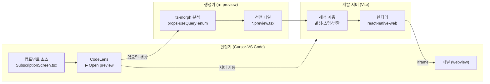

# 어떻게 도는가

앱을 빌드하고 부팅하지 않고 화면을 봅니다. 무엇을 줄였고 무엇을 대가로 냈는지 적습니다.

_English: [HOW-IT-WORKS.md](HOW-IT-WORKS.md)_

## 먼저: 런타임을 안 쓰는 게 아닙니다

가장 많이 받는 질문입니다. **코드를 실제로 실행합니다.** 정적 분석으로 그리는 것이 아닙니다.

Compose Preview 도 SwiftUI Preview 도 코드를 실행합니다. 전자는 안드로이드 프레임워크에서 하드웨어
의존을 걷어낸 `layoutlib` 을 데스크탑 JVM 에 올려 `@Composable` 을 리플렉션으로 부르고, 후자는
백그라운드에 시뮬레이터를 띄웁니다. **정적 분석만으로 그리는 프리뷰는 어느 플랫폼에도 없습니다.**
조건부 렌더링과 훅과 데이터 때문에 불가능합니다.

줄인 것은 런타임이 아니라 **런타임의 범위**입니다.

|                 | 앱                              | 프리뷰                      |
| --------------- | ------------------------------- | --------------------------- |
| 번들            | Metro                           | Vite                        |
| 실행 환경       | 네이티브(iOS·Android)           | 브라우저                    |
| 부팅            | 네이티브 앱 전체                | 없음                        |
| 초기화          | analytics·crash·트래커·codepush | 없음(빈 스텁으로 대체)      |
| 로그인          | 필요                            | 없음                        |
| 화면까지 이동   | 내비게이션으로 이동             | 없음(그 화면을 바로 마운트) |
| 서버            | 그 상태를 실제로 만들어야 함    | 선언에 적은 응답 고정       |
| 한 번에 보는 것 | 하나                            | 상태 × 기기 폭 조합 전부    |

**화면이 import 하는 모듈은 그대로 로드됩니다.** redux store 도 만들어지고 axios 클라이언트도
만들어집니다. 초기화가 안 도는 것은 저절로가 아니라 화면을 그리지 않는 패키지를 빈 스텁으로
바꿔뒀기 때문입니다.

가장 크게 얻는 것은 **상태를 만드는 비용**입니다. 실기에서 결제 실패 화면을 보려면 실제로 결제를
실패시켜야 합니다. 프리뷰에서는 선언 한 줄입니다.

## 전체 흐름



## 소스와 선언을 잇는 방법

선언에 "이 선언이 무엇을 그리는지" 를 적어두면 정보가 두 곳에 생겨 어긋납니다. **경로로 잇습니다.**

```text
<sourceRoot>/screens/account/SubscriptionScreen.tsx
        ↕ 같은 상대경로
<선언 디렉토리>/screens/account/SubscriptionScreen.preview.tsx
```

`sourceRoot` 는 프로젝트 설정이 `src` 같은 디렉토리를 지정하지 않으면 프로젝트 루트입니다.

덕분에 편집기 확장은 열려 있는 파일 경로만으로 선언 위치를 압니다. 목록도, 등록도 필요 없습니다.
없으면 그 자리에서 만듭니다.

선언 디렉토리 기본값은 대상 프로젝트의 `previews` 이고, `PREVIEW_DIR` 이나
`rn-preview.local.json` 으로 다른 곳을 가리킵니다.

선언을 팀 저장소에 넣고 싶지 않으면 무시되는 디렉토리로 빼서 가리킵니다. 개인 저장소로 나가는
symlink 를 두고 앱이 그 디렉토리를 통째로 무시하게 하면, **컴포넌트를 고치는 창에서 선언이 함께
보이면서 팀 저장소에는 안 들어가는** 자리가 됩니다.

## 선언은 데이터만 담습니다

```tsx
export default definePreview({
    component: SubscriptionScreen,
    variants: { 기본: {} },
    wrappers: ['query', 'navigation'],
    mockQueries: [{ key: subscriptionQueries.get().queryKey, data: SUBSCRIPTION }],
    states: {
        해지예약: [{ key: ..., data: { ...SUBSCRIPTION, status: 'cancel_scheduled' } }],
        로딩: [{ key: ..., pending: true }],
        조회실패: [{ key: ..., error: new Error('불러오지 못했습니다') }],
    },
});
```

JSX 를 받지 않습니다. `wrappers` 도 Provider 이름만 받습니다. 선언에 JSX 를 넣으면 그 자리에서
렌더러가 정해져서, 나중에 픽셀 확정용 네이티브 렌더러를 붙일 때 선언을 전부 다시 써야 합니다.

**화면은 props 가 아니라 데이터로 갈립니다.** 그래서 변형(props) 옆에 상태(서버 응답)를 따로 뒀습니다.
한 줄이 한 변형이고, 그 줄 안에 상태 × 기기 폭이 나란히 놓입니다.

## 해석 계층: 네이티브 코드를 웹에서 돌리는 부분

가장 손이 많이 간 곳입니다. `react-native` 를 `react-native-web` 으로 바꾸는 것만으로는 안 됩니다.

```mermaid
flowchart TD
    src["대상 프로젝트 소스"]

    src --> alias["별칭 해석<br/>(대상 프로젝트 tsconfig 에서 읽음)"]
    alias --> shim["react-native shim<br/>rnw + 네이티브 모듈 다리"]
    shim --> stub["빈 스텁<br/>analytics·푸시·권한·저장소·공유"]
    stub --> metro["Metro 전용 문법<br/>require() 자산·.svg"]
    metro --> worklet["빌드 의존 API<br/>reanimated worklet babel"]
    worklet --> style["RN 스타일 관용구<br/>top: undefined → auto"]
    style --> override["앱 코드 우회<br/>플랫폼 설정·isProduction·AB 배정"]
    override --> out["브라우저에서 실행"]
```

각 층이 왜 필요한지는 다음과 같습니다.

**react-native shim.** `react-native-web` 은 화면을 그리는 API 만 옮겨왔습니다. `TurboModuleRegistry`·
`requireNativeComponent`·`NativeModules` 같은 네이티브 모듈 다리는 없습니다. 그런데 앱이 쓰는 RN
패키지 상당수가 **모듈 최상단에서** 그것들을 import 하므로, 채워두지 않으면 그 패키지를 스치기만 해도
번들이 통째로 실패합니다.

> 패키지를 하나씩 스텁으로 바꾸는 방식은 수렴하지 않았습니다. 하나를 비우면 tree-shaking 경로가
> 바뀌면서 다른 패키지가 새로 딸려왔습니다. **모듈 표면을 채우는 쪽이 그래프 모양과 무관하게
> 성립합니다.**

**빈 스텁.** analytics·푸시·권한·저장소·로그인·공유는 화면을 그리지 않고, 여럿은 모듈 최상단에서
"이 플랫폼은 지원하지 않는다" 며 던집니다. 통째로 비웁니다. 비울 때 export 이름은 **진짜 패키지에서
읽어옵니다.** 손으로 적으면 패키지를 하나 비울 때마다 새 이름이 나와 끝나지 않았습니다.

**Metro 전용 문법.** `require('./x.png')` 자산 참조와 `.svg` import 는 Metro 가 다루는 것이라 웹
번들러에 없습니다. `require` 를 import 로 바꾸고, `.svg` 를 react-native-svg 컴포넌트로 바꿉니다.

**빌드 의존 API.** `useAnimatedStyle(() => ...)` 은 문법이 아니라 **빌드 단계에 기대는 API** 입니다.
reanimated 의 babel 플러그인이 콜백에서 참조하는 값을 찾아 의존성 배열로 넣어주는데, Vite 에는 그
단계가 없어 reanimated 가 "dependency array 없이 쓰였다" 며 던집니다. worklet 을 쓰는 파일만 골라
대상 프로젝트의 그 플러그인을 babel 로 돌립니다. `@vitejs/plugin-react` 6 은 oxc 로 바뀌면서 babel
플러그인을 받지 않아 별도 단계로 뒀습니다.

**RN 스타일 관용구.** 위치를 `undefined` 로 지우는 방식(`{ top: undefined }`)은 네이티브에서는
"값 없음" 이지만 react-native-web 은 그것을 건너뛰어 앞 스타일이 남습니다. CSS 에서 같은 뜻인
`auto` 로 바꿉니다.

**앱 코드 우회.** 앱 코드 일부가 ios·android 만 있다고 보고 씁니다(플랫폼 설정 모듈과 `isProduction`
헬퍼가 그 밖의 값에 던집니다). `Platform.OS` 를 `'ios'` 라고 속여봤더니 reanimated 가
웹 구현 대신 네이티브 경로를 골라 더 크게 깨졌습니다. **생태계 관례인 `'web'` 을 유지하고 그 두 곳만
프리뷰 전용 구현으로 돌립니다.** 대상 프로젝트는 한 줄도 고치지 않습니다.

AB 배정 selector 도 여기 있습니다. 배정은 앱 부트스트랩이 서버에서 받아 redux 에 넣는데 프리뷰에는
그 단계가 없고, 앱 selector 는 미배정을 fail-closed 로 `'A'` 로 봅니다. **플래그 뒤에 있는 화면이
통째로 빈 칸이 되고 그 이유가 화면에 안 드러납니다.** 배정을 선언에서 읽게 바꾸고, 적지 않은
실험은 노출군으로 봅니다.

## 자동 생성이 하는 것과 못 하는 것

`ts-morph` 로 소스를 읽어 선언 초안을 만듭니다.

|                  | 자동 | 근거                                                     |
| ---------------- | ---- | -------------------------------------------------------- |
| props 변형       | ✅   | 타입의 union·boolean 을 축으로 벌림                      |
| 판별 union 변형  | ✅   | 멤버마다 변형 하나. 그 멤버의 필수 prop 까지 채움        |
| 쿼리 키          | ✅   | `useQuery` 호출을 AST 로 찾음. 훅 두 겹까지 따라감       |
| mock 데이터 뼈대 | ✅   | 쿼리 반환 타입을 걸어 리터럴 생성                        |
| 로딩·에러 상태   | ✅   | 타입과 무관하게 항상 만듦                                |
| enum 분기 상태   | ✅   | enum 필드의 멤버마다 상태 생성                           |
| 값의 의미        | ❌   | 플랜 이름·금액 은 사람이 채움                            |
| 길이 경계·조합   | ❌   | 무엇이 볼 가치가 있는지는 사람이 앎                      |
| 요소를 받는 prop | ❌   | `ReactNode` 는 속성을 지어낼 수 없어 `undefined` 로 비움 |

**쿼리는 컴포넌트 파일에 없는 경우가 더 많습니다.** `useQuery` 를 `use{Name}Query` 훅으로 감싸 쓰는
코드베이스에서는 컴포넌트 파일만 보면 훅 호출 한 줄만 보여 쿼리가 없는 것처럼 읽힙니다. 그러면 초안에
`mockQueries` 가 안 들어가고, 데이터가 없어 `null` 을 반환하는 컴포넌트는 **빈 프리뷰**가 됩니다.
그래서 컴포넌트가 부르는 훅을 두 겹까지 따라가 그 안의 쿼리도 모읍니다. 같은 경로에서
`useNavigation` 을 쓰는지도 함께 봅니다.

**판별 union 은 그 컴포넌트가 몇 가지 모습으로 쓰이는지를 타입으로 적어둔 것입니다.** `Chip` 처럼
`type` 으로 갈리는 컴포넌트는 멤버마다 필수 prop 이 달라서, 공통 속성만 모으면 `title` 이 통째로
빠져 빈 칸이 나옵니다. 멤버별로 벌리면 손대지 않아도 네 모습이 다 나옵니다.

변형 이름은 **값이 멤버마다 다른 prop** 에서 가져옵니다. "리터럴인 첫 prop" 으로 고르면 모든 멤버가
같은 값을 갖는 prop 이 앞에 왔을 때 이름이 전부 같아지고, 객체 키가 겹쳐 마지막 하나만 남습니다.

목표는 완전 자동이 아니라 **초안 자동 + 다듬기**입니다. 다듬는 주체는 사람일 수도, 에이전트일 수도
있습니다. 선언이 데이터만 담기 때문에 둘 다 같은 파일을 고칩니다.

## 대가

근사입니다. `react-native-web` 은 `layoutlib` 과 같은 자리에 있습니다 — 플랫폼 렌더 스택을 다른
환경에 옮겨 심은 것이고, 안드로이드 개발자가 Compose Preview 를 쓰면서 감수하는 것과 같은 종류의
오차를 받아들이는 셈입니다.

오차는 두 종류입니다. **메울 수 있는 것**과 **남는 것**입니다.

메운 예. 바텀시트는 하단 버튼을 `[StyleSheet.absoluteFill, { top: undefined }]` 로 아래에
고정하는데, 네이티브는 `top` 이 해제되지만 react-native-web 은 `undefined` 를 건너뛰어 `top: 0` 이
남습니다. 버튼이 시트 위에 붙고 그만큼 내용이 밀려 아래가 넘쳤습니다. CSS 에서 같은 뜻인 `auto` 로
바꿔 해결했습니다.

남는 예. 시트의 드래그·스냅·애니메이션은 reanimated 와 gesture-handler 가 웹에서 다르게 도는 만큼
실기와 다릅니다. **열린 모양은 봐도 손으로 끌었을 때의 거동은 믿으면 안 됩니다.**

프리뷰가 실기와 다르게 보이는 것을 발견하면 둘 중 어느 쪽인지부터 가릅니다. 메울 수 있는 것이면
해석 계층에 한 겹 더하고, 남는 것이면 `COMPATIBILITY.ko.md` 에 적습니다.

**픽셀 판정은 이 도구 밖에 남습니다.** 필요하면 지금처럼 실기로 봅니다.

동작 여부와 알려진 한계는 `COMPATIBILITY.ko.md` 에 모읍니다.
