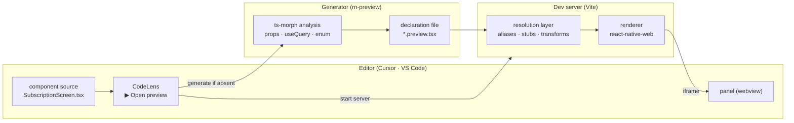

# How it works

Seeing a screen without building and booting the app. This is a record of what was cut and what it cost.

_Korean: [HOW-IT-WORKS.ko.md](HOW-IT-WORKS.ko.md)_

## First: this is not "no runtime"

The most common question. **The code really runs.** It is not drawn from static analysis.

Compose Preview and SwiftUI Preview both run code. The former strips hardware dependencies out of the Android
framework into `layoutlib`, loads it on a desktop JVM, and calls `@Composable` functions by reflection; the latter
starts a simulator in the background. **No platform has a preview that draws from static analysis alone.** Conditional
rendering, hooks, and data make it impossible.

What was cut is not the runtime but the **scope of the runtime.**

|                       | App                                               | Preview                                |
| --------------------- | ------------------------------------------------- | -------------------------------------- |
| Bundler               | Metro                                             | Vite                                   |
| Execution environment | native (iOS · Android)                            | browser                                |
| Boot                  | the whole native app                              | none                                   |
| Initialisation        | analytics · crash reporting · trackers · codepush | none (replaced by empty stubs)         |
| Login                 | required                                          | none                                   |
| Getting to the screen | navigate there                                    | none (that screen mounts directly)     |
| Server                | you have to actually produce that state           | responses fixed in the declaration     |
| Seen at once          | one                                               | every state × device-width combination |

**Modules the screen imports still load.** The redux store gets built; so does the axios client. Initialisation does
not run — not by itself, but because packages that draw nothing were swapped for empty stubs.

The biggest win is **the cost of producing a state.** On a device, seeing the payment-failure screen means actually
failing a payment. In a preview it is one line in a declaration.

## The whole flow



## How a source and a declaration are linked

Record "what this declaration draws" inside the declaration and the same fact now lives in two places, where it will
drift. **They are linked by path.**

```text
<sourceRoot>/screens/account/SubscriptionScreen.tsx
        ↕ same relative path
<declaration directory>/screens/account/SubscriptionScreen.preview.tsx
```

`sourceRoot` is the project root unless the project's config names a directory such as `src`.

That is how the editor extension knows where a declaration is from the open file's path alone. No registry, no
listing. If there is none, it is created on the spot.

The declaration directory defaults to `previews` in the target project; `PREVIEW_DIR` or `rn-preview.local.json`
points elsewhere.

If you would rather keep declarations out of the team repository, move them to an ignored directory and point at it.
A symlink out to a personal repository, plus a blanket ignore on that directory in the app, creates a spot where
**declarations are visible in the same window where you edit the component but never enter the team repository.**

## Declarations hold data only

```tsx
export default definePreview({
    component: SubscriptionScreen,
    variants: { default: {} },
    wrappers: ['query', 'navigation'],
    mockQueries: [{ key: subscriptionQueries.get().queryKey, data: SUBSCRIPTION }],
    states: {
        cancelScheduled: [{ key: ..., data: { ...SUBSCRIPTION, status: 'cancel_scheduled' } }],
        loading: [{ key: ..., pending: true }],
        fetchFailed: [{ key: ..., error: new Error('Could not load') }],
    },
});
```

No JSX is accepted. Even `wrappers` takes only provider names. Put JSX in a declaration and the renderer is decided
right there, which means rewriting every declaration when a native renderer is added for pixel-exact work.

**A screen's appearance is decided by data, not props.** So state (server responses) sits beside variants (props).
One row is one variant, and inside that row, state × device width sit side by side.

## The resolution layer: running native code on the web

This took the most work. Swapping `react-native` for `react-native-web` is nowhere near enough.

```mermaid
flowchart TD
    src["target project sources"]

    src --> alias["alias resolution<br/>read from the project's tsconfig"]
    alias --> shim["react-native shim<br/>rnw + native-module bridges"]
    shim --> stub["empty stubs<br/>analytics · push · permissions · storage · sharing"]
    stub --> metro["Metro-only syntax<br/>require() assets · .svg"]
    metro --> worklet["build-dependent API<br/>reanimated worklet babel"]
    worklet --> style["RN style idioms<br/>top: undefined → auto"]
    style --> override["app-code overrides<br/>config · isProduction · A/B selector"]
    override --> out["runs in the browser"]
```

Why each layer exists:

**react-native shim.** `react-native-web` ported only the drawing APIs. Native-module bridges like
`TurboModuleRegistry`, `requireNativeComponent`, and `NativeModules` are absent. Yet a good share of the RN packages
an app uses import them **at module top level**, so without those filled in, merely brushing against such a package
fails the whole bundle.

> Stubbing packages one at a time never converged. Emptying one shifted the tree-shaking path and a different package
> came along. **Filling in the module surface holds regardless of the shape of the graph.**

**Empty stubs.** Analytics, push, permissions, storage, login, and sharing draw nothing, and several throw at module
top level with "this platform is not supported". They are emptied wholesale. Export names for an emptied package are
**read from the real package.** Writing them by hand never finished: every package emptied surfaced new names.

**Metro-only syntax.** `require('./x.png')` asset references and `.svg` imports are Metro's business and absent from
web bundlers. `require` is rewritten to an import, and `.svg` to a react-native-svg component.

**Build-dependent API.** `useAnimatedStyle(() => ...)` is not syntax but an **API that depends on a build step.**
reanimated's babel plugin finds the values referenced in the callback and supplies them as a dependency array; Vite
has no such step, so reanimated throws "used without a dependency array". Only files that use worklets are routed
through the target project's copy of that plugin via babel. `@vitejs/plugin-react` 6 moved to oxc and no longer
accepts babel plugins, hence the separate step.

**RN style idioms.** Clearing a position with `undefined` (`{ top: undefined }`) means "no value" on native, but
react-native-web skips it and the preceding style survives. It is rewritten to `auto`, which means the same in CSS.

**App-code overrides.** Some app code is written as though only ios and android exist — a platform config module and
an `isProduction` helper that throw on anything else. Claiming `Platform.OS` is `'ios'` was tried and broke things
worse: reanimated then picked its native path instead of its web one. **The ecosystem convention `'web'` is kept and
only those two spots are routed to preview-only implementations.** The target project is not modified by a single line.

The A/B test selector belongs here too. Assignments are fetched by the app bootstrap and put in redux, a step a
preview does not have, and app selectors treat "unassigned" as fail-closed `'A'`. **A screen behind a flag becomes a
blank cell and the reason does not surface.** The selector is changed to read assignments from the declaration, and
any experiment not listed is treated as the exposed group.

## What generation does and does not do

`ts-morph` reads the source and produces a declaration draft.

|                        | Auto | Basis                                                           |
| ---------------------- | ---- | --------------------------------------------------------------- |
| Prop variants          | ✅   | Spreads the type's unions and booleans as axes                  |
| Discriminated variants | ✅   | One variant per member, including that member's required props  |
| Query keys             | ✅   | Finds `useQuery` calls in the AST. Follows two hook levels deep |
| Mock data skeletons    | ✅   | Generates a literal against the query's return type             |
| Loading · error states | ✅   | Always produced, independent of the type                        |
| Enum-branch states     | ✅   | One state per member of an enum field                           |
| What values mean       | ❌   | A plan name, a price — filled in by a person                    |
| Length edges · combos  | ❌   | Only a human knows what is worth looking at                     |
| Element-typed props    | ❌   | `ReactNode` cannot be invented, so it is left `undefined`       |

**More often than not, the query is not in the component file.** Codebases that wrap `useQuery` in a `use{Name}Query`
hook show only a one-line hook call in the component file, so it reads as though there is no query. The draft then
comes out without `mockQueries`, and a component that returns `null` without data becomes an **empty preview.** So the
hooks a component calls are followed two levels deep and the queries inside them are collected too. Whether
`useNavigation` is used along the same path is checked at the same time.

**A discriminated union is the type-level record of how many shapes a component is used in.** A component that
branches on `type` has different required props per member, so collecting only the shared props drops something like
`title` entirely and yields a blank cell. Spread per member and all four shapes appear untouched.

Variant names come from **a prop whose value differs per member.** Picking "the first literal prop" makes every name
identical when a prop shared across members comes first, and the object keys collide so only the last survives.

The goal is not full automation but **automatic draft plus manual polish.** The polisher may be a person or an agent.
Because a declaration holds data only, both edit the same file.

## The cost

It is an approximation. `react-native-web` occupies the same position as `layoutlib` — a platform render stack
transplanted into a different environment, accepting the same class of error an Android developer accepts when using
Compose Preview.

Errors come in two kinds: **closable** and **residual.**

A closed one. A bottom sheet pins its bottom button with `[StyleSheet.absoluteFill, { top: undefined }]`; native
releases `top`, but react-native-web skips `undefined` and `top: 0` survives. The button stuck to the top of the sheet
and the content shifted down and overflowed. Rewriting to `auto`, which means the same in CSS, fixed it.

A residual one. A sheet's dragging, snapping, and animation differ from a device to the extent reanimated and
gesture-handler behave differently on the web. **Trust the open geometry; do not trust the behaviour when you drag it.**

When a preview looks different from a device, sort out which kind it is first. Closable means one more layer in the
resolution stack; residual means a line in `COMPATIBILITY.md`.

**Pixel judgement stays outside this tool.** Use a real device for that, as before.

What works and the known limits are collected in [COMPATIBILITY.md](../COMPATIBILITY.md).
